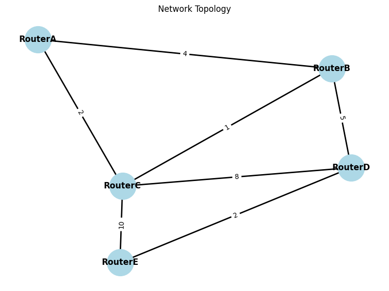
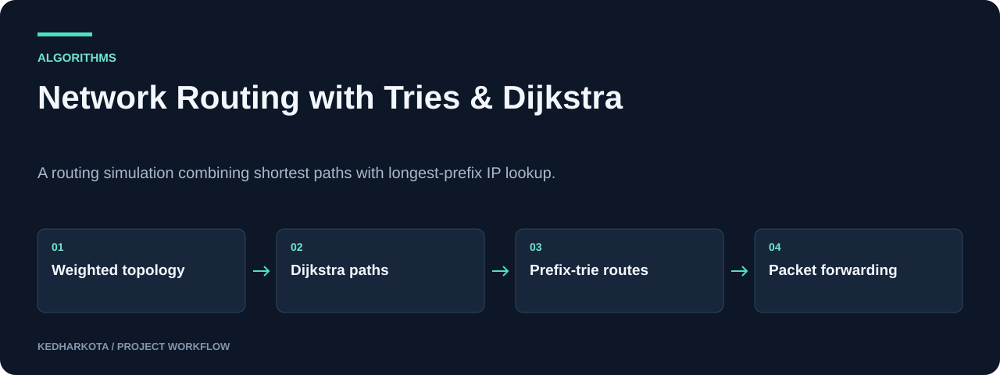

# Network Routing with Tries & Dijkstra

A routing simulation combining shortest paths with longest-prefix IP lookup.

**Python · Tries · Dijkstra · NetworkX · Graphviz**

[Overview](#overview) · [Getting started](#getting-started) · [Repository guide](#repository-guide) · [Reproducibility](docs/REPRODUCIBILITY.md)



*Original five-router topology saved in Project.ipynb.*

## Overview

A notebook implementation of a small IP routing simulation. Dijkstra's algorithm computes routes through a weighted router graph, while binary prefix tries choose next hops by longest-prefix match during packet forwarding.

## What this project includes

- Router and network abstractions with a predefined five-router topology.
- Heap-based Dijkstra shortest-path calculation.
- IPv4 prefix insertion and longest-prefix lookup using binary tries.
- Routing-table output, topology/trie visualizations, and forwarding with loop detection.

## Workflow



*Explanatory diagram. Detailed implementation and availability notes follow below.*

## Getting started

Install Python, Jupyter, and the visualization packages:

```bash
python -m pip install jupyter networkx matplotlib graphviz
```

Trie-image rendering also needs the Graphviz system executable `dot` on PATH; the Python `graphviz` package alone does not provide it.

Open `Project.ipynb` and run its code cell. The notebook defines the topology, computes tables, renders diagrams, and forwards a sample packet.

### Required inputs and current constraints

The topology is defined in code and needs no external dataset. The sample `192.168.5.10` address belongs to RouterD's `/24` network; an adjacent comment incorrectly labels it as RouterE. The implementation does not record a `/0` default route as an initial match, so treat it as a limited demonstration rather than a complete router.

## Repository guide

| File | Purpose |
| --- | --- |
| [Project.ipynb](Project.ipynb) | Complete routing simulation and saved topology output. |
| [A8(final).pdf](A8%28final%29.pdf) | Project documentation. |
| [Digital_DSA.pdf](Digital_DSA.pdf) | Supporting write-up. |
| [chdsa.docx](chdsa.docx) | Additional written material. |

## Results and project status

The topology figure below is an original saved notebook output. The simulation illustrates data structures and routing decisions; it is not a measured throughput or real-network deployment benchmark. Running the notebook also generates per-router trie PNGs.

## Next steps

- Correct the sample-destination comment and cover default-route behavior.
- Add focused algorithm checks for overlapping prefixes, disconnected routers, and forwarding loops.

## Documentation maintenance

Local documentation links and image headers are checked on pull requests and relevant pushes by the [documentation workflow](.github/workflows/docs.yml). Run the same check locally:

```bash
python tools/check_docs.py
```

See the [reproducibility guide](docs/REPRODUCIBILITY.md) for evidence, missing artifacts, and visual-source notes. The check validates documentation files; it does not train models or certify application behavior.

---

[More projects by kedharkota](https://github.com/kedharkota?tab=repositories)
